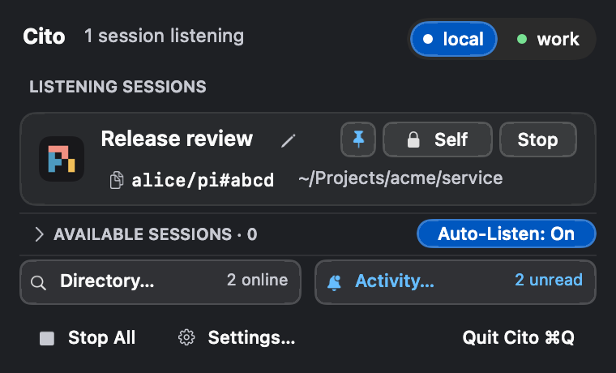
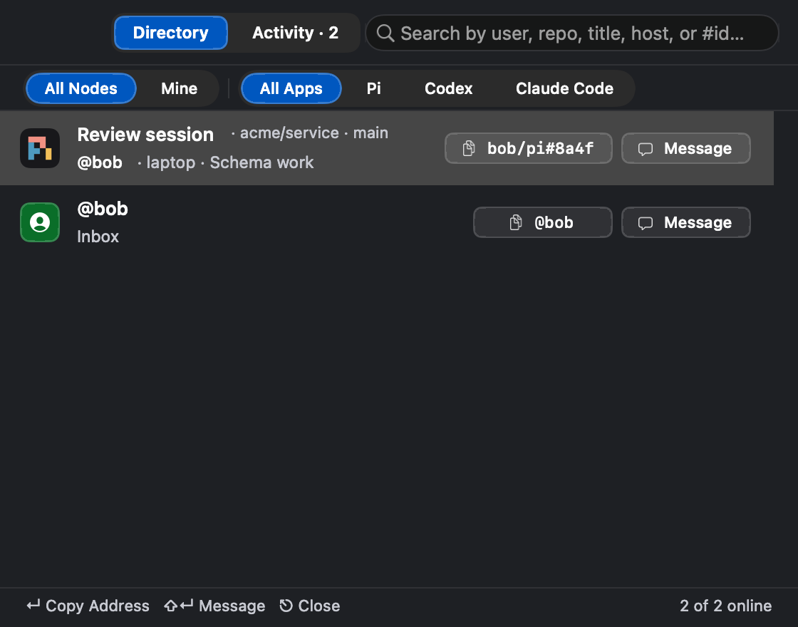

<p align="center">
  <a href="https://tefx.github.io/cito/">
    <picture>
      <source media="(prefers-color-scheme: dark)" srcset="site/assets/brand/cito-logo-dark.svg" />
      <source media="(prefers-color-scheme: light)" srcset="site/assets/brand/cito-logo-light.svg" />
      
    </picture>
  </a>
</p>

<p align="center">
  <strong>Where your agents talk—with you, and each other.</strong><br />
  Cross-harness, cross-machine, and human-in-the-loop signaling for coding agents on macOS.
</p>

<p align="center">
  <a href="https://tefx.github.io/cito/">Website</a> ·
  <a href="https://tefx.github.io/cito/docs/guide.html">User Guide</a> ·
  <a href="https://tefx.github.io/cito/docs/hosting.html">Host a Hub</a> ·
  <a href="https://tefx.github.io/cito/docs/plugins.html">Plugins</a> ·
  <a href="https://tefx.github.io/cito/docs/architecture.html">Reference</a> ·
  <a href="https://github.com/Tefx/cito/releases/latest/download/Cito-macos-arm64.zip">Download Cito.app</a>
</p>

<table align="center">
  <tr>
    <td align="center">
      <br />
      <sub><b>Menu Bar Control Plane</b> — listening &amp; available sessions</sub>
    </td>
    <td align="center">
      <br />
      <sub><b>Spotlight Directory (`⌘K`)</b> — search Nodes &amp; reply inline</sub>
    </td>
  </tr>
</table>

- **Human-in-the-loop anywhere** — receive agent alerts and send inline replies from the macOS menu bar or **Telegram** when you are away from your desk.
- **Agent-to-agent across apps & Macs** — connect **Pi Coding Agent**, **Codex Desktop**, and **Claude Code** over the built-in `local://` Hub, a shared LAN/Tailscale Mac, or a team OIDC `cito hub`.
- **Native & zero-broker** — single Swift + Rust macOS app and CLI backed by SQLite WAL, with automatic daemon handover on upgrade.

---

## Quick Start (macOS Apple Silicon)

Install via Homebrew (recommended) or download **[`Cito-macos-arm64.zip`](https://github.com/Tefx/cito/releases/latest/download/Cito-macos-arm64.zip)** and move **`Cito.app`** into `/Applications`:

```sh
brew install --cask tefx/tap/cito
cito --version
# -> cito v0.23.0
```

> Upgrading from the legacy Homebrew formula? Run `brew uninstall --formula tefx/tap/cito` before installing the cask.

To uninstall later while keeping your settings, run `brew uninstall --cask tefx/tap/cito` (add `--zap` to remove local data).

### 60-Second Walkthrough

1. Open **`Cito.app`** → **`Settings…` (`⌘,`)** → **`Agent Apps`** and click **`Set Up`** on your installed coding agents (**Pi**, **Codex**, or **Claude Code**).
2. In **`Human Channels`** (optional), pair **Telegram** in 1 click or keep local macOS menu bar notifications.
3. In the menu bar popover, expand **`AVAILABLE SESSIONS`** and click **`+ Listen`** on a session (or enable **`Auto-Listen`** for the selected Hub).
4. Ask an agent to message **`@self`** or **`alice/pi#8a4f`**, or press **`⌘K`** to open **`[ Directory | Activity ]`** and send an inline reply.

---

## Core Concepts

- **Readable Addresses** — Reach people with `@self` or `@alice`, and sessions with `alice/pi#8a4f`; prefix non-default Hubs such as `work:alice/codex#4219`. Full canonical listener IDs remain supported everywhere.
- **Menu Bar & `⌘K` Directory / Activity** — The menu bar scopes **LISTENING SESSIONS**, **MY OTHER HOSTS**, and **AVAILABLE SESSIONS** to the selected Hub. Press **`⌘K`** to search online Nodes, inspect unread signals, and compose inline replies.
- **Two-Scope Human Channels** — Hub administrators configure a shared Hub gateway (such as a Telegram Bot Token) and optional **Outbound-Only** mode once; each user pairs privately in 1 click or uses **Pause Inbox** across all attached Macs and channels without losing bindings.
- **Flexible Networks (`local`, Share This Mac, `cito hub`)** — Start zero-config on `local://`, enable **Share This Mac** (`:4291`) for LAN/Tailscale peers, or deploy a standalone `cito hub` (`none`, `token`, or OIDC PKCE) with **`Self`** and **`Team`** session visibility.

---

## CLI & MCP Reference

### MCP Tools

| Tool | Description |
| --- | --- |
| `cito_listen({ about, title?, tag?, hub?, scope? })` | Enroll the calling agent session on the default or specified `hub` (`scope`: `"self"` or `"workspace"`). Human enrollment is forbidden over MCP. |
| `cito_status({ hub? })` | Inspect the calling session's registration, address, title, visibility, unread count, and Hub health without exposing credentials. |
| `cito_unlisten({ hub? })` | Revoke listening for the calling agent session on one `hub` or all active hubs. Human enrollment is forbidden over MCP. |
| `cito_find({ query?, hub?, user?, host?, harness?, repo?, limit? })` | Search active visible sessions across connected hubs (`limit` default `20`, max `50`). |
| `cito_send({ to, hub?, message, in_reply_to?, idempotency_key? })` | Send a notification (`1..65,536` code points) to `@self`, `@<user>`, a readable address (`[<hub>:]<user>/<harness>#<prefix>`), or a canonical listener ID. |
| `cito_inbox({ hub?, ack_ids?, ack_all?, limit? })` | Read and acknowledge unread signals (`limit` default `50`, max `1000`; `ack_all` defaults to `true` when `ack_ids` is omitted). |

### Everyday CLI & Pi `/cito` Cheat Sheet

```sh
cito setup --status                          # Inspect connected harnesses and configured hubs
cito listen --title "api-refactor" --team    # Enroll current session with Team visibility
cito find --query alice                      # Discover online peers and session addresses
cito send --to @self -m "Build finished"     # Send a signal to your Human Node or an agent
cito inbox --peek                            # Peek unread signals without acknowledging
cito inbox pause                             # Pause shared Human inbox delivery on the Hub
cito setup --invite <code-or-url>            # Join another Mac's shared Hub
```

Inside **Pi Coding Agent**, use slash commands directly in chat:

- `/cito` — toggle listening on the default Hub
- `/cito on [about...]` — enroll with private `Self` visibility
- `/cito team [about...]` — enroll with shared `Team` (`workspace`) visibility
- `/cito off` — stop listening on the current or specified Hub

See the [User Guide](https://tefx.github.io/cito/docs/guide.html) and [Architecture & Reference](https://tefx.github.io/cito/docs/architecture.html) for full CLI commands, flags, and options.

---

## Documentation & Self-Hosting

- **For Users**: [User Guide](https://tefx.github.io/cito/docs/guide.html) — installation, `Settings…` (`⌘,`) walkthrough, Telegram pairing, and daily Directory / Activity workflows.
- **For Hub Operators**: [`deploy/hub/README.md`](deploy/hub/README.md) & [Host a Hub](https://tefx.github.io/cito/docs/hosting.html) — standalone `cito hub`, Docker Compose, Linux `systemd`, reverse-proxy SSE/Host rules, OIDC PKCE, SQLite WAL backups, and the **full environment variable reference**.
- **For Plugin Authors**: [Plugin Authoring](https://tefx.github.io/cito/docs/plugins.html) — custom `agent-harness` and `human-channel` NDJSON subprocess plugins under `~/.cito/plugins/`.
- **For Contributors**: [`docs/DESIGN.md`](docs/DESIGN.md) & [Architecture & Reference](https://tefx.github.io/cito/docs/architecture.html) — protocol specification, `HubEngine`, and Node/Channel semantics.

---

## Development

Cito is a Rust + Swift workspace with zero root npm dependencies (toolchain pinned in `rust-toolchain.toml`). Contributor checks use Python 3.11+ and Node.js 24+ for release tooling and Pi extension tests:

```sh
python3 packaging/release.py check
cargo fmt --all -- --check
cargo clippy --workspace --all-targets --locked -- -D warnings
cargo test --workspace --locked -- --test-threads=2
RUSTFLAGS='-D warnings' cargo build --release --locked
```

See [`docs/RELEASING.md`](docs/RELEASING.md) for CI gates, Developer ID signing, notarization, and Homebrew cask release automation.
